# Animated Cursors

| [Shapes](#shapes-animated_shapes_cursors) | [Dot](#dot-animated_dot_cursors) | [Fluid](#fluid-animated_fluid_cursors) | [Hand](#hand-animated_hand_cursors) |
| :---: | :---: | :---: | :---: |
| 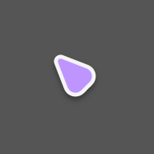 |  | 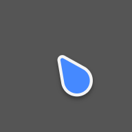 | 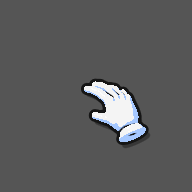 |

Xcursor themes drawn from code, morphing between cursors in compositors that
support it and plain animated cursors everywhere else.

## Compositor support

Transitions need a compositor that plays them. See [`patches/`](patches/README.md)
for the spec and a Niri patch.

## Themes

Previews are 64 px. Transitions are slowed down four times and play both ways.

Every theme comes in the bundled palettes `carburetor` (default), `catppuccin`
and `gruvbox`. Pick one with `--palette`, or pass a path to your own
`role = #rrggbb` file (see `crates/<theme>/colors`). With the flake, override
`palette` and any role in `colors`.

### Shapes (`animated_shapes_cursors`)

Material 3 Expressive shapes.

#### Idle

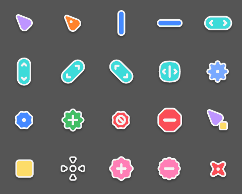

#### Transitions

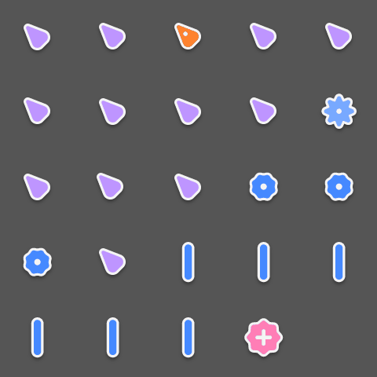

#### Palettes

Rows are Carburetor, Catppuccin Mocha and Gruvbox dark.

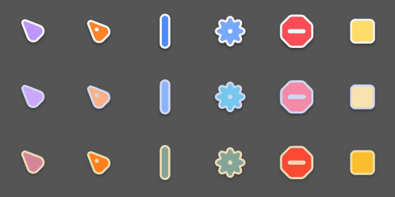

| Role | Colors |
| --- | --- |
| `arrow` | default and progress arrow |
| `link` | pointer |
| `text` | text and vertical-text |
| `resize` | resize cursors |
| `grab` | grab |
| `grabbing` | grabbing |
| `copy` | copy |
| `refuse` | no-drop and not-allowed |
| `crosshair` | crosshair |
| `zoom` | zoom lens |
| `load0` .. `load6` | busy indicator shapes |
| `glyph` | marks drawn on shapes |
| `border` | outline |
| `shadow` | drop shadow |

```nix
animated-cursors.packages.${system}.shapes.override {
  palette = "catppuccin";
  colors.link = "#f5c2e7";
}
```

### Dot (`animated_dot_cursors`)

Minimal dots and rings.

#### Idle

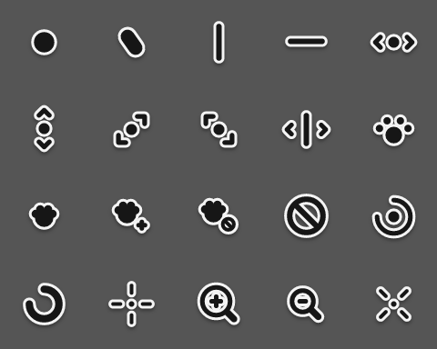

#### Transitions

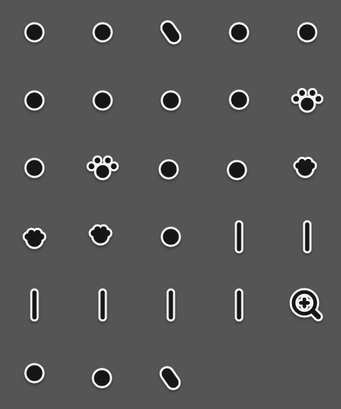

#### Palettes

Rows are Carburetor, Catppuccin Mocha and Gruvbox dark.

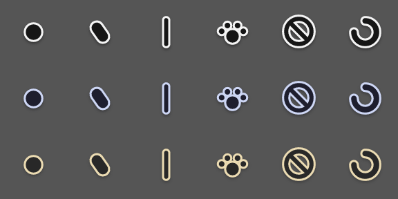

| Role | Colors |
| --- | --- |
| `ink` | fill |
| `border` | outline |
| `shadow` | drop shadow |

```nix
animated-cursors.packages.${system}.dot.override {
  palette = "catppuccin";
  colors.ink = "#f5c2e7";
}
```

### Fluid (`animated_fluid_cursors`)

Liquid metaballs.

#### Idle

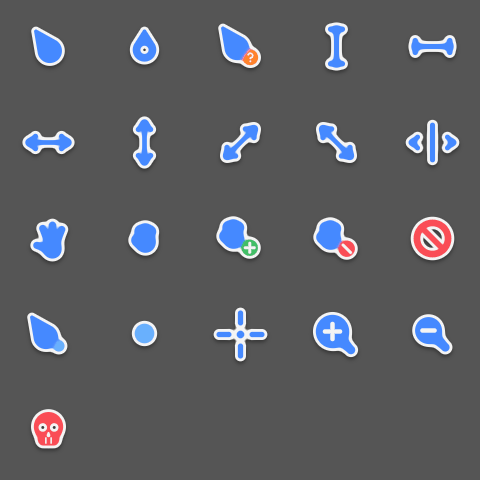

#### Transitions

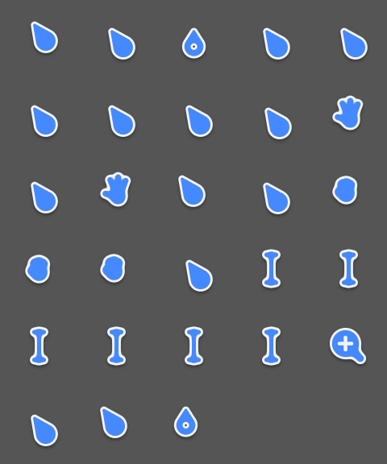

#### Palettes

Rows are Carburetor, Catppuccin Mocha and Gruvbox dark.

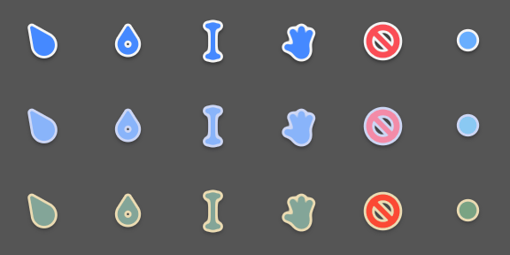

| Role | Colors |
| --- | --- |
| `arrow` | default and progress arrow |
| `link` | pointer |
| `text` | text and vertical-text |
| `resize` | resize cursors |
| `grab` | grab and grabbing |
| `crosshair` | crosshair |
| `zoom` | zoom lens |
| `busy` | busy cell |
| `split` | cell splitting off |
| `copy` | copy badge |
| `refuse` | no-drop and not-allowed |
| `border` | outline |
| `shadow` | drop shadow |

```nix
animated-cursors.packages.${system}.fluid.override {
  palette = "catppuccin";
  colors.arrow = "#f5c2e7";
}
```

### Hand (`animated_hand_cursors`)

Cel-shaded 3D gloves after Master Hand.

#### Idle

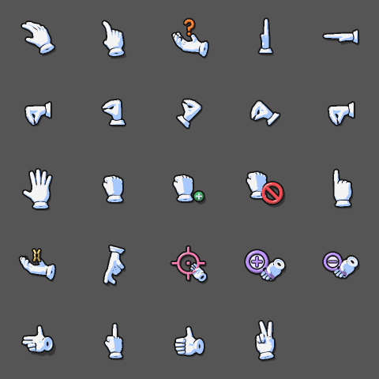

#### Transitions

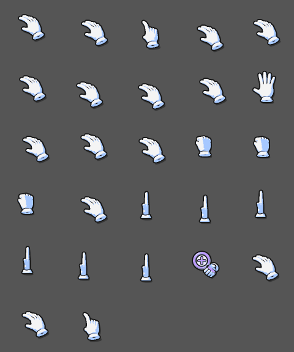

#### Palettes

Rows are Carburetor, Catppuccin Mocha and Gruvbox dark.

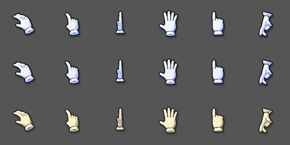

| Role | Colors |
| --- | --- |
| `glove` | glove |
| `shade` | glove shading |
| `ink` | outlines |
| `text` | text cursors |
| `resize` | resize cursors |
| `crosshair` | crosshair |
| `zoom` | zoom lens |
| `busy` | busy cursors |
| `copy` | copy badge |
| `refuse` | no-drop and not-allowed |
| `shadow` | drop shadow |

```nix
animated-cursors.packages.${system}.hand.override {
  palette = "catppuccin";
  colors.glove = "#f5c2e7";
}
```

## Build

```sh
nix build .#shapes                       # theme in result/share/icons
nix build .#dot
nix build .#fluid
nix build .#hand
nix build .#fluid-catppuccin             # every theme has -catppuccin and -gruvbox
nix build .#niri --out-link result-niri  # patched Niri 26.04
```

Locally:

```sh
nix develop
cargo test
cargo run --release -p fluid-cursors -- --output build/fluid
cargo run --release -p fluid-cursors -- --output build/fluid --sizes 24,48 --palette gruvbox
cargo run --release -p fluid-cursors -- --preview previews/fluid
```

## License

GPL-3.0-or-later. See [LICENSE](LICENSE).
