# Animated Cursors

Xcursor themes drawn from code, morphing between cursors in compositors that
support it and plain animated cursors everywhere else.

- [Compositor support](#compositor-support)
- [Palettes](#palettes)
- [Themes](#themes)
  - [Shapes](#shapes-animated_shapes_cursors)
  - [Dot](#dot-animated_dot_cursors)
  - [Fluid](#fluid-animated_fluid_cursors)
  - [Hand](#hand-animated_hand_cursors)
- [Build](#build)
- [License](#license)

## Compositor support

Transitions need a compositor that plays them. See [`patches/`](patches/README.md)
for the spec and a Niri patch.

## Palettes

| | Carburetor | Catppuccin Mocha | Gruvbox dark |
| --- | --- | --- | --- |
| Shapes | 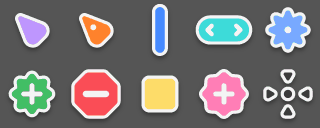 | 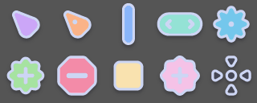 | 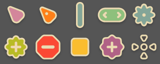 |
| Dot | 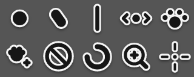 | 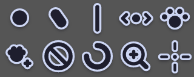 | 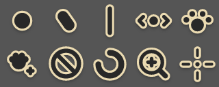 |
| Fluid | 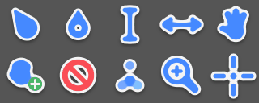 | 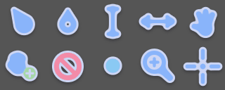 | 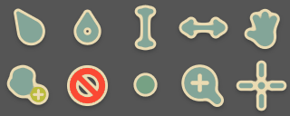 |
| Hand | 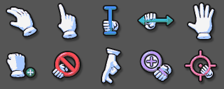 | 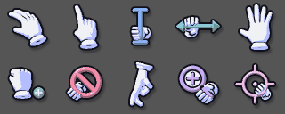 | 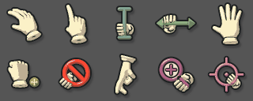 |

Pick one with `--palette carburetor|catppuccin|gruvbox` or a path to your own
`role = #rrggbb` file (see `crates/<theme>/colors`). With the flake:

```nix
animated-cursors.packages.${system}.fluid.override {
  palette = "catppuccin";
  colors.arrow = "#f5c2e7";
}
```

## Themes

Previews are 64 px; transitions are slowed down and play both ways.

### Shapes (`animated_shapes_cursors`)

Material 3 Expressive shapes.

#### Cursors

| | | | | |
| --- | --- | --- | --- | --- |
| 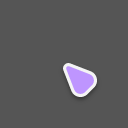<br><sub>default</sub> | <br><sub>pointer</sub> | <br><sub>text</sub> | <br><sub>vertical-text</sub> | 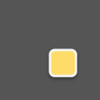<br><sub>wait</sub> |
| 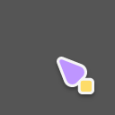<br><sub>progress</sub> | <br><sub>grab</sub> | <br><sub>grabbing</sub> | <br><sub>copy</sub> | <br><sub>no-drop</sub> |
| <br><sub>not-allowed</sub> | <br><sub>zoom-in</sub> | 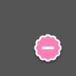<br><sub>zoom-out</sub> | 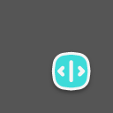<br><sub>col-resize</sub> | <br><sub>ew-resize</sub> |
| 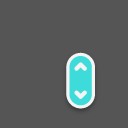<br><sub>ns-resize</sub> | <br><sub>nesw-resize</sub> | <br><sub>nwse-resize</sub> | 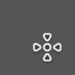<br><sub>crosshair</sub> | |

#### Transitions

| | | | | |
| --- | --- | --- | --- | --- |
| <br><sub>default / col-resize</sub> | <br><sub>default / crosshair</sub> | <br><sub>default / ew-resize</sub> | <br><sub>default / grab</sub> | <br><sub>default / grabbing</sub> |
| <br><sub>default / nesw-resize</sub> | <br><sub>default / ns-resize</sub> | <br><sub>default / nwse-resize</sub> | <br><sub>default / pointer</sub> | <br><sub>default / progress</sub> |
| <br><sub>default / text</sub> | <br><sub>default / wait</sub> | <br><sub>grab / grabbing</sub> | <br><sub>grabbing / copy</sub> | <br><sub>grabbing / no-drop</sub> |
| <br><sub>grabbing / not-allowed</sub> | <br><sub>pointer / text</sub> | <br><sub>text / col-resize</sub> | <br><sub>text / ew-resize</sub> | <br><sub>text / nesw-resize</sub> |
| <br><sub>text / ns-resize</sub> | <br><sub>text / nwse-resize</sub> | <br><sub>text / vertical-text</sub> | <br><sub>zoom-in / zoom-out</sub> |  |

### Dot (`animated_dot_cursors`)

Minimal dots and rings.

#### Cursors

| | | | | |
| --- | --- | --- | --- | --- |
| <br><sub>default</sub> | <br><sub>pointer</sub> | <br><sub>text</sub> | <br><sub>vertical-text</sub> | <br><sub>wait</sub> |
| <br><sub>progress</sub> | <br><sub>grab</sub> | <br><sub>grabbing</sub> | <br><sub>copy</sub> | <br><sub>no-drop</sub> |
| <br><sub>not-allowed</sub> | <br><sub>zoom-in</sub> | <br><sub>zoom-out</sub> | <br><sub>col-resize</sub> | <br><sub>ew-resize</sub> |
| <br><sub>ns-resize</sub> | <br><sub>nesw-resize</sub> | <br><sub>nwse-resize</sub> | <br><sub>crosshair</sub> | |

#### Transitions

| | | | | |
| --- | --- | --- | --- | --- |
| <br><sub>default / col-resize</sub> | <br><sub>default / crosshair</sub> | <br><sub>default / ew-resize</sub> | <br><sub>default / grab</sub> | <br><sub>default / grabbing</sub> |
| <br><sub>default / nesw-resize</sub> | <br><sub>default / ns-resize</sub> | <br><sub>default / nwse-resize</sub> | <br><sub>default / pointer</sub> | <br><sub>default / progress</sub> |
| <br><sub>default / text</sub> | <br><sub>default / wait</sub> | <br><sub>grab / grabbing</sub> | <br><sub>grabbing / copy</sub> | <br><sub>grabbing / no-drop</sub> |
| <br><sub>grabbing / not-allowed</sub> | <br><sub>pointer / text</sub> | <br><sub>text / col-resize</sub> | <br><sub>text / ew-resize</sub> | <br><sub>text / nesw-resize</sub> |
| <br><sub>text / ns-resize</sub> | <br><sub>text / nwse-resize</sub> | <br><sub>text / vertical-text</sub> | <br><sub>zoom-in / zoom-out</sub> |  |

### Fluid (`animated_fluid_cursors`)

Liquid metaballs.

#### Cursors

| | | | | |
| --- | --- | --- | --- | --- |
| 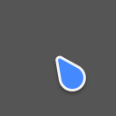<br><sub>default</sub> | 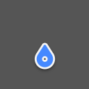<br><sub>pointer</sub> | <br><sub>text</sub> | <br><sub>vertical-text</sub> | <br><sub>wait</sub> |
| 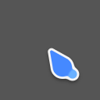<br><sub>progress</sub> | <br><sub>grab</sub> | <br><sub>grabbing</sub> | <br><sub>copy</sub> | <br><sub>no-drop</sub> |
| <br><sub>not-allowed</sub> | <br><sub>zoom-in</sub> | <br><sub>zoom-out</sub> | <br><sub>col-resize</sub> | <br><sub>ew-resize</sub> |
| 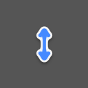<br><sub>ns-resize</sub> | 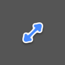<br><sub>nesw-resize</sub> | 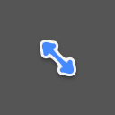<br><sub>nwse-resize</sub> | <br><sub>crosshair</sub> | |

#### Transitions

| | | | | |
| --- | --- | --- | --- | --- |
| <br><sub>default / col-resize</sub> | <br><sub>default / crosshair</sub> | <br><sub>default / ew-resize</sub> | <br><sub>default / grab</sub> | <br><sub>default / grabbing</sub> |
| <br><sub>default / nesw-resize</sub> | <br><sub>default / ns-resize</sub> | <br><sub>default / nwse-resize</sub> | <br><sub>default / pointer</sub> | <br><sub>default / progress</sub> |
| <br><sub>default / text</sub> | <br><sub>default / wait</sub> | <br><sub>grab / grabbing</sub> | <br><sub>grabbing / copy</sub> | <br><sub>grabbing / no-drop</sub> |
| <br><sub>grabbing / not-allowed</sub> | <br><sub>pointer / text</sub> | <br><sub>text / col-resize</sub> | <br><sub>text / ew-resize</sub> | <br><sub>text / nesw-resize</sub> |
| <br><sub>text / ns-resize</sub> | <br><sub>text / nwse-resize</sub> | <br><sub>text / vertical-text</sub> | <br><sub>zoom-in / zoom-out</sub> |  |

### Hand (`animated_hand_cursors`)

Cel-shaded 3D gloves after Master Hand.

#### Cursors

| | | | | |
| --- | --- | --- | --- | --- |
| 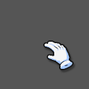<br><sub>default</sub> | 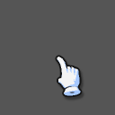<br><sub>pointer</sub> | 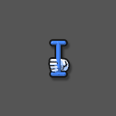<br><sub>text</sub> | 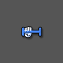<br><sub>vertical-text</sub> | 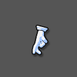<br><sub>wait</sub> |
| 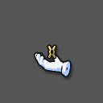<br><sub>progress</sub> | 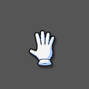<br><sub>grab</sub> | 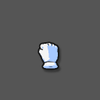<br><sub>grabbing</sub> | 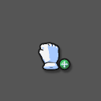<br><sub>copy</sub> | 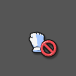<br><sub>no-drop</sub> |
| 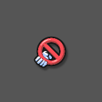<br><sub>not-allowed</sub> | 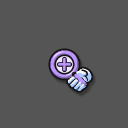<br><sub>zoom-in</sub> | 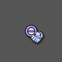<br><sub>zoom-out</sub> | 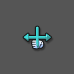<br><sub>col-resize</sub> | 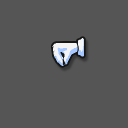<br><sub>ew-resize</sub> |
| 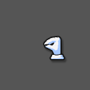<br><sub>ns-resize</sub> | 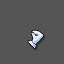<br><sub>nesw-resize</sub> | 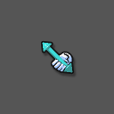<br><sub>nwse-resize</sub> | 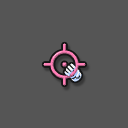<br><sub>crosshair</sub> | |

#### Transitions

| | | | | |
| --- | --- | --- | --- | --- |
| <br><sub>default / col-resize</sub> | <br><sub>default / crosshair</sub> | <br><sub>default / ew-resize</sub> | <br><sub>default / grab</sub> | <br><sub>default / grabbing</sub> |
| <br><sub>default / nesw-resize</sub> | <br><sub>default / ns-resize</sub> | <br><sub>default / nwse-resize</sub> | <br><sub>default / pointer</sub> | <br><sub>default / progress</sub> |
| <br><sub>default / text</sub> | <br><sub>default / wait</sub> | <br><sub>grab / grabbing</sub> | <br><sub>grabbing / copy</sub> | <br><sub>grabbing / no-drop</sub> |
| <br><sub>grabbing / not-allowed</sub> | <br><sub>pointer / text</sub> | <br><sub>text / col-resize</sub> | 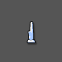<br><sub>text / ew-resize</sub> | <br><sub>text / nesw-resize</sub> |
| <br><sub>text / ns-resize</sub> | <br><sub>text / nwse-resize</sub> | <br><sub>text / vertical-text</sub> | <br><sub>zoom-in / zoom-out</sub> |  |

## Build

```sh
nix build .#shapes                       # theme in result/share/icons
nix build .#dot
nix build .#fluid
nix build .#hand
nix build .#fluid-catppuccin             # every theme has -catppuccin and -gruvbox
nix build .#niri --out-link result-niri  # patched Niri 26.04
```

Locally:

```sh
nix develop
cargo test
cargo run --release -p fluid-cursors -- --output build/fluid --preview previews/fluid
cargo run --release -p fluid-cursors -- --output build/fluid --sizes 24,48 --palette gruvbox
cargo run --release -p fluid-cursors -- --sheet previews/palettes/fluid-gruvbox.gif --palette gruvbox
```

## License

GPL-3.0-or-later. See [LICENSE](LICENSE).
